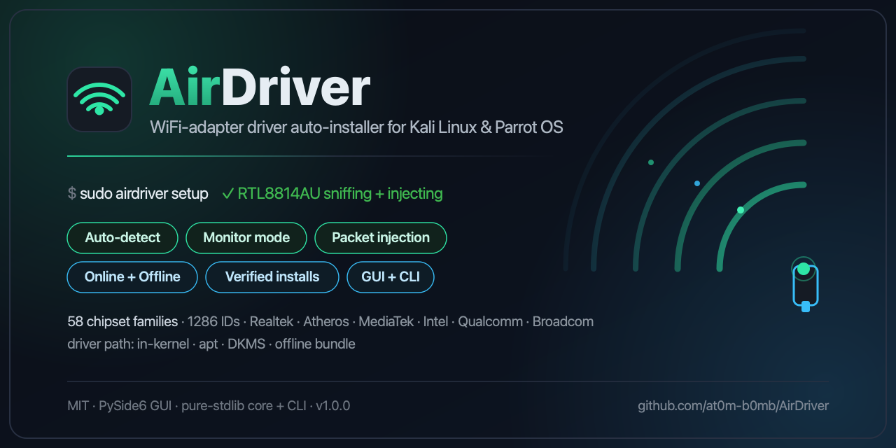
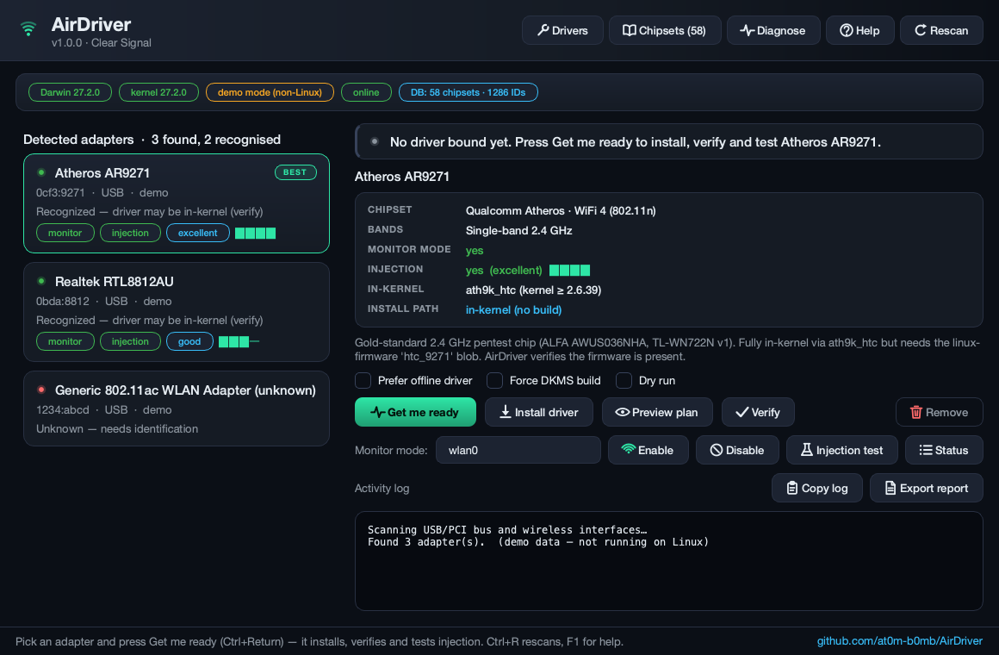
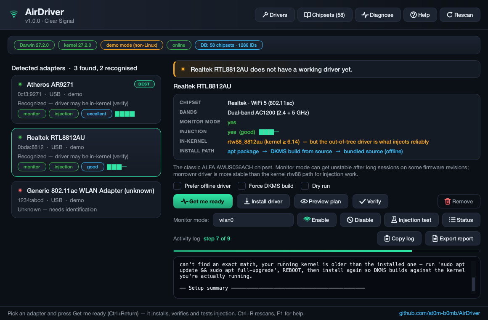
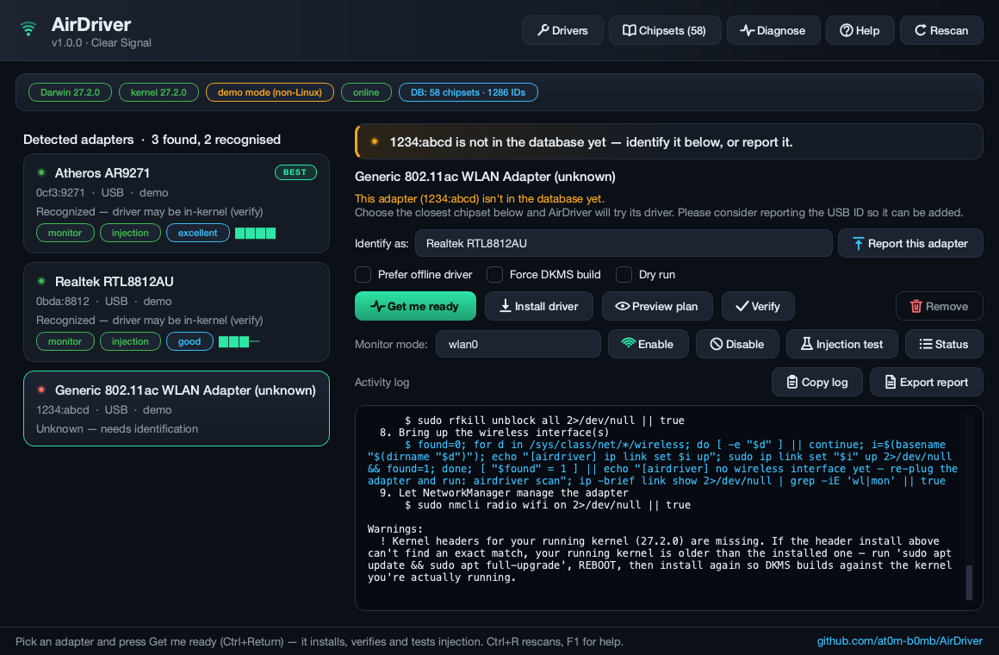
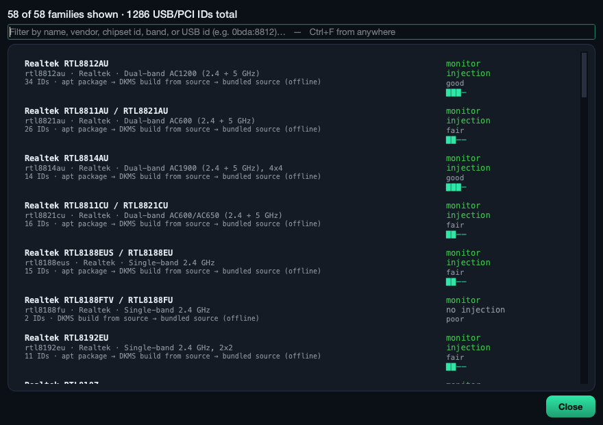
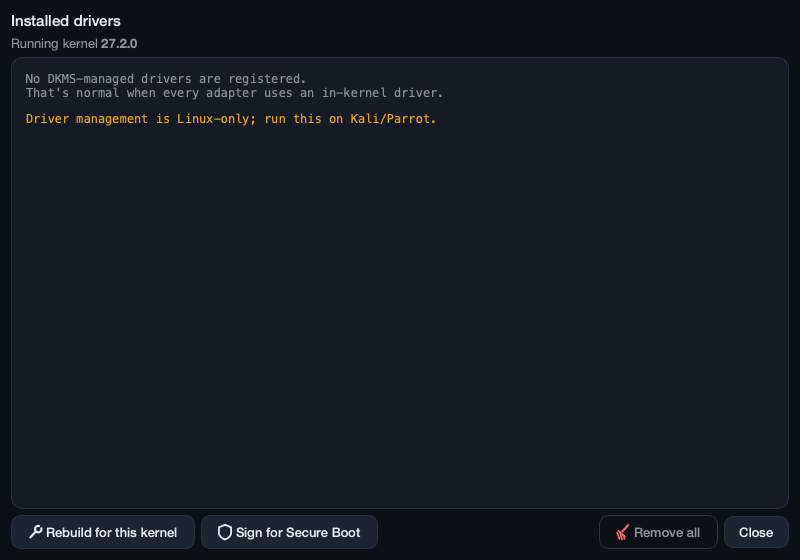
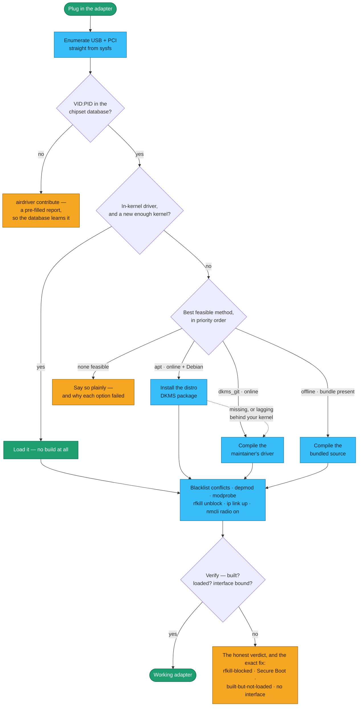

<div align="center">



<h3>Plug in the adapter. Run one command. Get monitor mode and injection.</h3>

<p><em>AirDriver identifies your Wi-Fi chipset, installs the driver that actually works for it,<br>
then proves the thing is loaded, bound, sniffing and injecting — or tells you exactly why it isn't.</em></p>

[](../../releases/latest)
[](../../actions)
[](https://at0m-b0mb.github.io/AirDriver/)
[](LICENSE)

[](https://www.kali.org/)
[](https://www.python.org/)
[](https://doc.qt.io/qtforpython/)
[](#development--tests)
[](CONTRIBUTING.md)

**[Browse every supported chipset →](https://at0m-b0mb.github.io/AirDriver/)**

</div>

```console
$ sudo airdriver setup

  ✓ Detect adapter      ALFA AWUS036ACH  (0bda:8812, USB)
  ✓ Capability          monitor yes · injection good
  ✓ System readiness    kernel 6.12.13-amd64, headers + DKMS present
  ✓ Driver              install plan ran clean (dkms_git)
  ✓ Verify              88XXau bound to wlan1
  ✓ Monitor mode        wlan1mon is in monitor mode
  ✓ Injection           aireplay-ng confirmed injection on wlan1mon

  Realtek RTL8812AU is pentest-ready — sniffing and injection both confirmed.
```

---

<table>
<tr>
<td width="50%" valign="top">

### The problem

Getting an ALFA/Panda/TP-Link adapter working on Kali is a rite of passage. Work out
the chipset. Find the right DKMS repo — half are abandoned. Install headers that match
the kernel you are *running*, not the one you installed. Fight Secure Boot. Blacklist
the in-tree module that keeps stealing the device.

Then the build says `0`, and the adapter still does nothing.

And the catch‑22: no driver means no internet, which means you cannot download the driver.

</td>
<td width="50%" valign="top">

### What AirDriver does

Reads your hardware out of **sysfs**, matches it against **1286 USB/PCI IDs**, and picks
the best of four install paths — in-kernel, apt, DKMS from the maintainer's git, or a
**bundled offline copy** for the air-gapped case.

Then it checks the driver really **bound**, unblocks rfkill, brings the interface up,
switches on monitor mode and runs the injection self-test.

One verdict at the end. No guessing, and nothing claimed that wasn't observed.

</td>
</tr>
</table>

---

<details>
<summary><b>Contents</b></summary>

[Quick start](#-quick-start) ·
[What you get](#what-you-get) ·
[Honesty, specifically](#honesty-specifically) ·
[Screenshots](#screenshots) ·
[Install & run](#install--run) ·
[Usage](#usage) ·
[Troubleshooting](#-troubleshooting) ·
[Supported chipsets](#supported-chipsets) ·
[How driver selection works](#how-driver-selection-works) ·
[Report an adapter](#adapter-not-recognised-report-it-in-30-seconds) ·
[Adding a chipset](#adding-a-chipset) ·
[Development & tests](#development--tests) ·
[Responsible use](#%EF%B8%8F-responsible-use) ·
[What's new](#whats-new) ·
[Contributing](#contributing)

</details>

## ⚡ Quick start

**One line — nothing to clone:**

```bash
curl -fsSL https://raw.githubusercontent.com/at0m-b0mb/AirDriver/main/install.sh | sudo bash
```

That installs the dependencies, the GUI, and the `airdriver` command. Then **one
command does the whole job** — plugged in to injection confirmed:

```bash
sudo airdriver setup     # detect → install → verify → monitor mode → injection test
```

…or open the GUI and press **Get me ready**, which runs exactly the same thing:

```bash
sudo airdriver           # opens the GUI
```

**Prefer to read the script first?** (Always a fair instinct for a `curl | bash`.)

```bash
git clone https://github.com/at0m-b0mb/AirDriver
cd AirDriver
sudo ./install.sh        # installs deps + the `airdriver` command
sudo airdriver           # opens the GUI
```

**Changed your mind?** Undoing it is one line too:

```bash
sudo ./uninstall.sh              # remove AirDriver, keep the Wi-Fi drivers it installed
sudo ./uninstall.sh --drivers    # …and remove those drivers as well
```

**Don't want to install anything system-wide?** Just run it from the folder:

```bash
git clone https://github.com/at0m-b0mb/AirDriver
cd AirDriver
./run.sh                 # sets up a local env on first run, then launches the GUI
./run.sh scan            # …or any CLI command
```

> **No graphical desktop / over SSH?** Everything works headless from the CLI —
> `airdriver scan`, `airdriver doctor`, `airdriver install`. No GUI libraries needed.

Stuck on the first run? Jump to [**Troubleshooting**](#-troubleshooting) — the two most
common gotchas (the GUI not opening under `sudo`, and Qt `xcb` errors) are solved there.

## What you get

| | |
|---|---|
| ⭐ **One command, end to end** | `airdriver setup` goes from *plugged in* to *injection confirmed* — detect, install, verify it bound, monitor mode, injection self-test — and finishes with **one honest verdict**. The GUI's **Get me ready** runs exactly the same flow. |
| 🔍 **Detection from the kernel itself** | USB and PCI devices come straight out of **sysfs**, not scraped from `lsusb`/`lspci`, so a minimal install with no `usbutils` still detects everything. Interfaces are matched to adapters **by sysfs device path**, so a dongle's `wlan1` is never reported against the internal card. |
| 🧠 **Four install paths, best one chosen** | In-kernel (skip the build entirely) → apt → DKMS from the maintainer's git → a bundled offline copy. Out-of-tree builds run the maintainer's own `install-driver.sh` non-interactively, which is the supported way to do it. |
| 🎯 **Injection-first where it matters** | For the chipsets people buy *for* injection, a newer kernel is not automatically the right answer. AirDriver builds the out-of-tree driver anyway and says why — `--prefer-kernel` if you only need to get online. |
| ✅ **Verified, not assumed** | After the build it checks the module is **built, loaded and bound**, reads monitor mode back from **sysfs** rather than trusting `airmon-ng`'s exit code, and names the exact fix when something is wrong. |
| 🔧 **Survives kernel upgrades** | The #1 way Wi-Fi "randomly breaks" on Kali. `airdriver status` spots the stale module instantly; `airdriver rebuild` fixes it. |
| 🔐 **Secure Boot** | `airdriver sign` generates a MOK key, signs every built module (handling compressed `.ko.xz`/`.zst` properly) and hands you the one step that needs your own password. |
| 🩺 **One-shot `diagnose`** | A complete snapshot — kernel, headers, Secure Boot, rfkill, USB/PCI, interfaces, modules, DKMS, `dmesg` tail — copied to your clipboard. The single thing to paste when you ask for help. |
| 💿 **Air-gapped installs** | Pre-fetch driver sources while you have internet; build them on a machine that has none. |
| 🖥️ **GUI and CLI, equally complete** | A PySide6 app with keyboard shortcuts, and a full CLI for headless boxes over SSH. Neither is a second-class citizen. |

<details>
<summary><b>…and the rest</b> (click to expand)</summary>

- 🔁 **Auto-fallback installs** — when the apt package is missing or hasn't caught up with
  your kernel, AirDriver transparently compiles the maintainer's driver from source in the
  same run, installing build prerequisites on the fly, instead of just failing.
- 📡 **Brings it online** — after loading the module it unblocks `rfkill`, brings the
  interface up and nudges NetworkManager, because a loaded module is not a working adapter.
- 💿 **Flip-storage dongles** — many cheap adapters boot as a fake CD-ROM full of Windows
  drivers and never appear as Wi-Fi. AirDriver spots them; `airdriver modeswitch` ejects it.
- 🧹 **Remove & fix** — `airdriver remove` cleanly wipes a half-broken driver for a fresh
  retry (and un-blacklists the in-kernel one, so you are never left with *no* driver);
  `airdriver fix` reloads it. Both surface the relevant `dmesg`.
- 🚫 **Conflict handling** — blacklists in-tree modules that hijack adapters meant for the
  out-of-tree driver, and puts them back on removal.
- 📶 **Monitor mode + injection** — enable/disable and run the `aireplay-ng` self-test from
  the GUI or `airdriver monitor status|start|stop|test`.
- 📚 **Searchable chipset browser** — filter all 58 families and 1286 IDs by name, vendor,
  band or `vid:pid`, in the GUI or on the [web](https://at0m-b0mb.github.io/AirDriver/).
- 🛒 **Buying advice** — `airdriver recommend` ranks the chipsets that genuinely do monitor
  mode *and* injection, preferring ones that need no driver build at all.
- 🤖 **Scriptable** — `scan --json`, `db --json`, `status --json`; `db --check` validates the
  database and runs in CI on every commit.
- 📄 **Diagnostic reports** — JSON + Markdown, written to *your* home directory even when the
  tool is running under `sudo`.
- ❓ **Unknown-adapter flow** — pick the closest chipset to try, then **Report this adapter**
  (or `airdriver contribute`) and AirDriver writes the whole report for you: USB descriptors,
  kernel, `dmesg`. Never your adapter's serial number — that report goes to a public issue.
- 🖌️ **Renders on a bare box** — every icon is drawn with QPainter, not emoji, so the UI
  looks right on a minimal Kali install with no emoji font.

</details>

## Honesty, specifically

Most driver tools tell you they succeeded. This one tells you what it observed. That
distinction is the whole design, and it is enforced by tests:

- **A chipset that cannot inject is hardware, not a failed install.** AirDriver says so
  instead of reporting an error, and `recommend` never offers it.
- **A failed injection test says "not confirmed here."** `aireplay-ng --test` legitimately
  fails with no AP in range; blaming your driver for that would be a lie.
- **Monitor mode is read back from sysfs**, never inferred from `airmon-ng`'s exit code.
- **Capability flags come from kernel source, not from recall.** `mac80211` always adds
  `NL80211_IFTYPE_MONITOR`, so every softmac driver can sniff — which is why
  **QCA6390/WCN6855 are flagged as unable to sniff at all**: `ath11k`'s own hardware table
  sets `supports_monitor = false` and clears the flag back out.
- **Injection is claimed only with a track record.** New silicon is marked `unknown`, not
  optimistically `true`.
- **A `vid:pid` claimed by two different drivers is not guessed at.** Seven of them sit in
  a `contested_ids` list, and AirDriver explains the situation rather than installing a
  driver that blacklists the other one's module:

  ```console
  $ airdriver info 148f:760a

    148f:760a  (deliberately unassigned)

      Claimed by two drivers (mt7601u, mt76x0u) — AirDriver will not guess.
      Two different in-kernel drivers claim this id, so which chip is
      actually inside depends on the hardware revision. Let the kernel
      bind whichever it recognises — confirm with 'airdriver diagnose' —
      and do not force a driver.
  ```

## Screenshots

<div align="center">

**Main view** — ranked adapters with the most capable one flagged, a spec grid, and live system status (headers · DKMS · Secure Boot):



<br/><br/>

**One press does everything** — a real progress bar driven by the install steps, a colour-coded log, and the verdict at the top:



<br/><br/>

**Unknown adapter?** Identify it from the dropdown, preview every command before anything runs — and **Report this adapter** to get it added to the database:



<br/><br/>

**Know before you buy** — search all 58 chipset families and 1286 USB/PCI IDs, with honest monitor/injection flags:



<br/><br/>

**Driver management** — what is installed, whether it is built for the kernel you are running, and the two repairs people actually need:



</div>

> The screenshots run on macOS, where AirDriver shows **demo adapters** so the GUI is
> previewable without hardware. On Kali/Parrot it detects your real ones.

### Keyboard shortcuts

| | | | |
|---|---|---|---|
| <kbd>Ctrl</kbd>+<kbd>↵</kbd> | Get me ready | <kbd>Ctrl</kbd>+<kbd>R</kbd> / <kbd>F5</kbd> | Rescan |
| <kbd>Ctrl</kbd>+<kbd>I</kbd> | Install driver | <kbd>Ctrl</kbd>+<kbd>P</kbd> | Preview plan |
| <kbd>Ctrl</kbd>+<kbd>K</kbd> | Verify | <kbd>Ctrl</kbd>+<kbd>D</kbd> | Diagnose |
| <kbd>Ctrl</kbd>+<kbd>F</kbd> | Chipset browser | <kbd>F1</kbd> | Help |
| <kbd>Ctrl</kbd>+<kbd>L</kbd> | Clear log | <kbd>Ctrl</kbd>+<kbd>Shift</kbd>+<kbd>C</kbd> | Copy log |

## Install & run

### Option A — full install (recommended)

```bash
sudo ./install.sh
```

The installer:
- installs system prerequisites — `dkms`, `build-essential`, kernel headers, `iw`,
  `aircrack-ng`, … plus `usbutils`/`pciutils`, which are **optional**: detection reads
  sysfs directly and works without them.
- installs the **Qt runtime libraries** the GUI needs (the usual cause of
  *"installed but the window won't open"*),
- creates an isolated virtualenv and installs the GUI (PySide6),
- drops a smart `airdriver` launcher on your PATH.

Then:

```bash
sudo airdriver           # GUI (installs run as root — smoothest)
airdriver scan           # CLI: list detected adapters
airdriver doctor         # CLI: is the system ready to build drivers?
```

> Core + CLI are **pure stdlib** — they run on a stock box with zero pip installs.
> Only the GUI needs `PySide6`.

### Option B — run without installing

```bash
./run.sh                 # GUI    (no root needed; install steps ask for sudo)
./run.sh scan            # or any CLI command
```

### Option C — Make targets

```bash
make install             # = sudo ./install.sh
make gui                 # set up a local venv and launch the GUI
make scan                # CLI scan
make doctor              # CLI readiness check
make offline             # pre-fetch driver sources for air-gapped use
make test                # run the test suite
make uninstall           # remove AirDriver (keeps your Wi-Fi drivers)
make purge               # remove AirDriver *and* every driver it installed
make help                # list everything
```

### Uninstalling

Two separate things can be removed, and AirDriver keeps them separate on purpose —
uninstalling the tool should not take your Wi-Fi down with it.

```bash
sudo ./uninstall.sh              # remove AirDriver; drivers keep working
sudo ./uninstall.sh --drivers    # also remove every driver AirDriver installed
sudo ./uninstall.sh --all        # …and delete the Secure Boot signing key
```

To clear the drivers but keep AirDriver around:

```bash
sudo airdriver remove --all              # every driver AirDriver installed
sudo airdriver remove --all --dry-run    # show exactly what would go, change nothing
sudo airdriver remove rtl8812au          # just one chipset
```

Removal also deletes AirDriver's modprobe blacklist and loads the in-kernel driver back,
so your adapter falls back to the kernel's own driver rather than being left with none.
DKMS entries are matched against the chipset database first, so unrelated modules
(VirtualBox, NVIDIA) are never touched.

### Bundle drivers for offline use (do it while online)

```bash
./scripts/fetch_offline_drivers.sh
```

This pre-clones the DKMS driver repos into `airdriver/data/drivers/` so AirDriver can
build them later on a machine with **no internet**.

## Usage

### GUI

```bash
sudo airdriver           # launch the graphical app
```

Adapters are listed most-capable first, with the best one flagged **BEST**. Pick one,
check the spec grid, and press **Get me ready** (<kbd>Ctrl</kbd>+<kbd>↵</kbd>) — that
one button installs, verifies, enables monitor mode and tests injection, with a progress
bar and a colour-coded log as it goes. The strip at the top of the pane always answers
"is this adapter ready?".

Tick **Dry run** to see every command without running any of them. **Install driver**,
**Preview plan**, **Verify** and **Remove** drive the same engine one step at a time.
**F1** has a built-in quick start and troubleshooter.

### CLI

```bash
airdriver setup                 # ⭐ the whole job in one command
airdriver setup --dry-run       # …show what it would do, change nothing
airdriver setup --no-inject     # driver + monitor mode, skip the injection test
airdriver setup 0cf3:9271       # set up a specific adapter
airdriver scan                  # list detected adapters
airdriver scan --json           # …machine-readable, for scripts
airdriver doctor                # system readiness (headers, dkms, secure boot…)
airdriver info 0bda:8812        # database details for a usb id / chipset id
airdriver install               # install driver for the first known adapter
airdriver install rtl8812au --dry-run   # preview the plan for a chipset
airdriver install 0bda:c811 --offline   # force the bundled offline driver
airdriver install rtl8812au --prefer-kernel  # use the in-kernel driver even where the
                                #   out-of-tree one injects better (just get me online)
airdriver verify                # did the driver really install, load & bind?
airdriver fix                   # reload the driver (depmod + modprobe) and re-check
airdriver remove rtl8814au      # cleanly remove a driver to retry from scratch
airdriver remove --all          # remove every driver AirDriver installed
airdriver remove --all --dry-run  # …show what that would do, change nothing
airdriver diagnose              # full snapshot to share when stuck (rfkill, dmesg, dkms…)
airdriver monitor status        # show each interface's current mode
airdriver monitor start         # enable monitor mode (defaults to the interface found)
airdriver monitor test wlan0mon # aireplay-ng injection self-test
airdriver report                # write a JSON + Markdown diagnostic report
airdriver db                    # dump the chipset database
airdriver db --check            # validate the database (exit non-zero on conflicts)
```

### Driver management

```bash
airdriver status                # what's installed — and is it built for THIS kernel?
airdriver rebuild               # rebuild DKMS drivers after a kernel upgrade
airdriver sign                  # sign modules so Secure Boot will load them
airdriver modeswitch            # kick a "driver CD-ROM" dongle into WiFi mode
airdriver recommend --band 5    # which adapter should I actually buy/use?
airdriver contribute            # report an unknown adapter to the project
```

**Wi-Fi died after `apt full-upgrade`?** That's a stale DKMS module, and it's a
two-command fix:

```bash
airdriver status                # shows "NOT built — stale" against the new kernel
sudo airdriver rebuild          # rebuilds, reloads, and re-checks
```

Every install ends with a **verification report** — it confirms the module is built,
loaded, and bound to your adapter, or tells you precisely what to fix.

## 🛟 Troubleshooting

**The GUI won't open when I run `sudo airdriver` / I get a Qt `xcb` error.**
This is the #1 issue and AirDriver now handles it for you:
- Running a GUI under `sudo` normally breaks the X11 connection. AirDriver's launcher
  re-attaches your desktop session automatically, so `sudo airdriver` *should* just work.
- If you still see `could not load the Qt platform plugin "xcb"`, the Qt runtime libs
  are missing. Install them:
  ```bash
  sudo apt install -y libxcb-cursor0 libxkbcommon-x11-0 libegl1 \
                      libxcb-icccm4 libxcb-image0 libxcb-keysyms1 \
                      libxcb-randr0 libxcb-render-util0 libxcb-shape0
  ```
  (`sudo ./install.sh` installs all of these for you.)

**The driver "installed" but my adapter still doesn't work.**
First, get the full picture in one command (it's also copied to your clipboard):
```bash
sudo airdriver diagnose       # share this output when asking for help
```
Then re-check or recover:
```bash
airdriver verify              # is it built, loaded, and bound to the adapter?
airdriver fix                 # reload it (depmod + modprobe) and re-check
airdriver remove <chipset> && airdriver install <chipset>   # clean retry from scratch
```
The usual culprits (AirDriver now handles the first two automatically, but check them if
it's still dead):
- **Radio is rfkill-blocked** — the module loads but the radio is soft-blocked, so nothing
  transmits. Fix: `sudo rfkill unblock all`.
- **Interface is down** — `sudo ip link set wlan0 up` (AirDriver does this after install).
- **Secure Boot is ON** — a freshly built DKMS module is unsigned, so the kernel refuses
  to load it. Disable Secure Boot in firmware, or `sudo mokutil --disable-validation`
  then reboot and follow the blue MOK screen.
- **No re-plug / reboot yet** — unplug and re-plug the adapter, then `airdriver scan`.
  High-power cards like the **AWUS1900 (RTL8814AU)** want a USB 2.0 port or a *powered*
  hub — they can brown-out on an unpowered USB 3 port.
- **Kernel headers don't match the running kernel** — if you upgraded but didn't reboot,
  DKMS builds for the wrong kernel. `sudo apt update && sudo apt full-upgrade`, **reboot**,
  then `airdriver remove <chipset> && airdriver install <chipset>`.

**Wi-Fi worked yesterday, then I updated the system and it's gone.**
Your kernel changed and the out-of-tree module wasn't rebuilt for the new one:
```bash
airdriver status              # "NOT built — stale" against the running kernel
sudo airdriver rebuild        # rebuild, reload, re-check
```
If the rebuild can't find matching headers, you're running an *older* kernel than the one
installed — reboot into the newest kernel first, then rebuild.

**My new dongle shows up as a CD drive / "Windows driver" disk, not Wi-Fi.**
It's in flip-storage mode and must be ejected before the radio appears:
```bash
sudo airdriver modeswitch     # detects it, or pass the id: ... modeswitch 0bda:1a2b
airdriver scan                # it comes back with a DIFFERENT usb id
```

**Secure Boot keeps refusing my freshly built driver.**
```bash
sudo airdriver sign                                  # makes a key + signs the modules
sudo mokutil --import /var/lib/airdriver/MOK.der     # you pick a one-time password
sudo reboot                                          # blue screen → Enroll MOK → Continue
```

**`airdriver: command not found` after installing.**
The launcher went to `~/.local/bin` (non-root install). Add it to your PATH:
```bash
echo 'export PATH="$HOME/.local/bin:$PATH"' >> ~/.bashrc && source ~/.bashrc
```
…or just re-run `sudo ./install.sh` to put it in `/usr/local/bin`, or use `./run.sh`.

**`error: externally-managed-environment` when I tried `pip install`.**
That's modern Debian/Kali (PEP 668) blocking system-wide pip. Don't fight it — use
`./install.sh` or `./run.sh`; both create an isolated virtualenv that side-steps it.

**No display at all (headless box / SSH).**
Skip the GUI entirely — the CLI does everything: `airdriver scan`, `doctor`, `install`,
`monitor`, `report`.

**My adapter shows up as "unknown".**
Select it, choose the closest chipset under **Identify as** (GUI) or run
`airdriver install <vid:pid>` (CLI). Please [open an issue](https://github.com/at0m-b0mb/AirDriver/issues)
with the `VID:PID` so it can be added to the database.

## Supported chipsets

AirDriver knows **58 chipset families** spanning **1286 USB/PCI IDs**. Capabilities are
honest — some chips connect fine but can't inject, and AirDriver tells you up front.
(Run `airdriver db` for the full list, or the **📚 Chipsets** browser in the GUI.)

> **Where the IDs come from.** Every `vid:pid` is taken from the Linux kernel's own driver
> device tables (`rtl8xxxu`, `rt2800usb`, `ath9k_htc`, `carl9170`, `mt76*`, `rtw88`/`rtw89`,
> `rtl8187`, `ath5k`, `ath11k`, `ath12k`, `rsi`, `p54`, `zd1211rw`) and, for out-of-tree
> drivers, the maintainers' `supported-device-IDs` lists. **None are guessed** — a wrong id
> installs the wrong driver, and the install blacklists the right one's module, so a bad
> guess leaves the adapter with no driver at all. Where two drivers claim the same id, it
> goes in `contested_ids` and AirDriver explains instead of choosing.

### 🏆 Attack-grade — reliable monitor mode + injection

| Chipset | Typical adapters | Bands | Injection | Driver path |
|---|---|---|---|---|
| **MT7612U** | Alfa AWUS036ACM, Panda PAU09 | 2.4+5 AC1200 | **excellent** | in-kernel (4.19+) |
| **RTL8187** | Alfa AWUS036H | 2.4 G | **excellent** | in-kernel |
| **AR9271** | Alfa AWUS036NHA, TL-WN722N **v1** | 2.4 N | **excellent** | in-kernel + firmware |
| **RTL8812AU** | Alfa AWUS036ACH | 2.4+5 AC1200 | good | apt → DKMS → offline (in-kernel 6.14+) |
| **RTL8814AU** | Alfa AWUS1900 | 2.4+5 AC1900 | good | apt → DKMS → offline (in-kernel 6.16+) |
| **AR7010** | Alfa AWUS051NH v2 | 2.4+5 N | good | in-kernel + firmware |
| **RT3070 / RT5370** | Alfa AWUS036NH, Panda PAU06 | 2.4 N | good | in-kernel (rt2800usb) |
| **RT3572 / RT5572** | Alfa AWUS051NH/052NH, Panda PAU09 | 2.4+5 N | good | in-kernel (rt2800usb) |
| **RT2800-series (other)** | 300+ rebadged RT2870/307x/35xx/53xx/55xx sticks | 2.4 (some 5) | good | in-kernel (rt2800usb) |
| **MT7610U** | Alfa AWUS036ACHM | 2.4+5 AC600 | good | in-kernel (4.19+) |
| **MT7921AU** | Alfa AWUS036AXML, Brostrend AX9L | WiFi 6E | good | in-kernel (5.18+) |
| **MT7925U** | Netgear A9000 | WiFi 7 | good | in-kernel (6.7+) |
| **AR5xxx (ath5k)** | Atheros AR5212 miniPCI, Ubiquiti SR2/SR5 | 2.4+5 a/b/g | good | in-kernel |
| **RT73 / RT2501USB** | mid-2000s Ralink USB rebadges | 2.4 G | good | in-kernel + firmware |

### 👍 Works — fair injection

| Chipset | Typical adapters | Bands | Driver path |
|---|---|---|---|
| RTL8811AU/8821AU | Alfa AWUS036ACS | 2.4+5 AC600 | apt → DKMS → offline (in-kernel 6.14+) |
| RTL8811CU/8821CU | TP-Link T2U Nano/Plus | 2.4+5 AC600 | apt → DKMS → offline |
| RTL8822BU/8812BU | TP-Link Archer T3U/T4U v3 | 2.4+5 AC1200 | apt → DKMS (morrownr 88x2bu) |
| RTL8188EUS | TL-WN722N **v2/v3** | 2.4 N | DKMS (blacklists `r8188eu`) |
| RTL8192EU | TL-WN822N v4/v5 | 2.4 N | apt → DKMS |
| RTL8852BU/8832BU | Alfa AWUS036AXM | WiFi 6 | DKMS (morrownr) / in-kernel 6.17+ |
| RTL8852CU/8832CU | generic AXE | WiFi 6E | DKMS (morrownr) / in-kernel 6.19+ |
| ZD1211 / ZD1211B | ZyXEL G-220, 3Com 3CRUSB10075 | 2.4 G | in-kernel + firmware |
| RT2500USB (RT2570) | early Ralink USB rebadges | 2.4 G | in-kernel |
| Prism54 USB (p54usb) | 3COM 3CRWE254G72, D-Link DWL-G122 | 2.4 G | in-kernel + firmware |

### 🔌 Connect-only — gets you online, **not** for attacks

| Chipset | Notes |
|---|---|
| RTL8192CU / RTL8188CUS | Edimax EW-7811Un, TL-WN725N v2 — flaky monitor, unreliable injection |
| RTL8723BU | WiFi+BT combo dongles — connectivity only |
| RTL8188FU | cheap mini dongles — limited monitor |
| RTL8710BU / RTL8188GU | newer budget nano (Tenda W311MI) — often ships in CD-ROM mode; monitor sniffing only |
| RTL8723AU | older WiFi+BT combo — connectivity only |
| RTL8192FU | newer budget 2.4 GHz — needs kernel **6.2+** for the in-kernel driver |
| MT7601U | ultra-cheap nano — monitor sniffing only, **no injection** |
| RTL8822CU / RTL8822CS | AC1200 dongles & SBC modules — in-kernel `rtw88_8822cu` (6.2+), sniffs, injection unproven |
| RTL8723DU | budget WiFi+BT combo — in-kernel `rtw88_8723du` (6.2+), connectivity |
| MT7663U / MT7668AU | LG & generic AC dongles — in-kernel `mt7663u` (5.8+) + firmware |
| RS9113 / RS9116 | Redpine/Silicon Labs embedded dual-band N — in-kernel `rsi_91x` + firmware |
| AR9170 (carl9170) | legacy draft-N — weak injection |
| AR5523 (USB) | legacy a/b/g USB — monitor works, injection **unproven** (flagged unknown, not promised) |

### 💻 Internal laptop cards (PCIe) — fixes "no WiFi after install"

Most "my Wi-Fi doesn't work on Kali" reports are about the card already inside the
laptop, so these are covered in depth. Note how few of them can inject — if a table row
says **no**, no amount of reinstalling will change it, and you want a USB adapter from
the [attack-grade](#-attack-grade--reliable-monitor-mode--injection) list instead.

| Chipset | Covers | Driver | Monitor | Injection |
|---|---|---|:--:|:--:|
| **Atheros AR5416–AR9565** | Dell DW1520, ThinkPad AR9285, Compex WLE200NX | `ath9k` (in-kernel) | ✅ | 🏆 **excellent** |
| MediaTek MT7921E / MT7922 / MT7925E | AMD laptops, RZ616 / RZ717 | `mt7921e` (6.6+) | ✅ | 🙂 fair |
| Qualcomm QCA6174 / QCA9377 / QCA988x | Killer 1435, DW1810 | `ath10k` | ✅ | ❌ firmware limitation |
| Intel 7260 / 7265 / 3165 / 8260 / 8265 / 9260 / 9560 | 2014–2020 laptops | `iwlwifi` | ✅ | ❌ |
| Intel AX200 / AX201 / AX210 / AX211 | 2020+ laptops | `iwlwifi` | ✅ | ❌ |
| Intel BE200 / BE201 (WiFi 7) | 2024+ laptops — needs kernel **6.7+** | `iwlwifi` | ✅ | ❌ |
| RTL8852AE / 8852BE / 8852CE / 8922AE | 2022+ budget & gaming laptops | `rtw89` (5.16+) | ✅ | ❌ |
| RTL8821CE / RTL8822CE / RTL8723DE | very common Lenovo/HP/Acer cards | `rtw88` | ✅ | ❌ |
| RTL8188CE / 8192CE / 8723AE / 8723BE / 8821AE | older Realtek PCIe | `rtlwifi` | ✅ | ❌ |
| **Qualcomm QCA6390 / WCN6855** | 2021+ Dell/Lenovo/HP, Killer AX1675 | `ath11k` | ❌ **cannot** | ❌ |
| Qualcomm QCN9074 | AP/enterprise M.2 | `ath11k` (5.13+) | ✅ | ❓ unproven |
| Qualcomm WCN7850 (WiFi 7) | 2024+ laptops, FastConnect 7800 | `ath12k` (6.3+) | ✅ | ❓ unproven |
| MediaTek MT7915 / MT7916 | AP-class miniPCIe / M.2 cards | `mt7915e` (5.11+) | ✅ | ❓ unproven |
| MediaTek MT7996 / MT7992 (WiFi 7) | Wi-Fi 7 M.2 modules — needs a recent kernel | `mt7996e` | ✅ | ❓ unproven |
| Intel 1000–6000 / Centrino-N | 2009–2013 laptops | `iwlwifi` | ✅ | ❌ |
| **Atheros AR5xxx** | pre-2008 miniPCI, Ubiquiti SR-series | `ath5k` (in-kernel) | ✅ | 🏆 **good** |
| **Broadcom BCM43xx** | MacBooks, DW1550, BCM43142 | `broadcom-sta-dkms` (`wl`) | ❌ | ❌ |
| **Broadcom FullMAC** | Raspberry Pi 3/4/5, MacBook BCM4364 | `brcmfmac` (in-kernel) | ❌ **cannot** | ❌ |

> **Atheros `ath9k` is the one to have.** It's in-kernel, needs no firmware blob, and has
> the most reliable monitor mode and injection of any chipset in the database — better
> than most USB adapters people buy. If your laptop has one, you're already set.
>
> **Broadcom is the one to avoid.** The proprietary `wl` driver supports neither monitor
> mode nor injection. AirDriver installs it so you at least get internet, and blacklists
> the conflicting `b43`/`brcmsmac` modules — but for any real work, use a USB adapter.
> Some pre-2012 cards do monitor fine on the open `b43` driver, which is worth a try.

> The full database lives in [`airdriver/data/chipsets.json`](airdriver/data/chipsets.json)
> and is trivial to extend — add a `VID:PID` or a whole chipset and AirDriver picks it up.
> See [Adding a chipset](#adding-a-chipset).

## How driver selection works



Before any build, AirDriver verifies kernel headers, DKMS, and build tools are
present, warns about Secure Boot, and blacklists conflicting in-tree modules.

If the chosen **apt** package can't be installed (missing on your distro, or lagging
behind your kernel), the same step **falls back to compiling the maintainer's driver
from git** automatically — installing the build prerequisites on the fly — so a single
"Install" still ends in a working driver.

## Adapter not recognised? Report it in 30 seconds

The database only covers what people send back. If your adapter is unknown — or matched
to the wrong chipset — AirDriver writes the whole report for you:

```bash
airdriver contribute            # prints the report + a pre-filled issue link
airdriver contribute --open     # …and opens it in your browser
```

It collects the `vid:pid`, the USB descriptors (from `lsusb -v`, or from sysfs when
`usbutils` isn't installed — never the serial number), your kernel and distro, and the
matching `dmesg` lines. In the GUI, select the adapter and press **Report this adapter**.

> **Nothing is sent automatically.** The report describes your machine, so AirDriver shows
> it to you and pre-fills the form — you decide whether to submit.

See [CONTRIBUTING.md](CONTRIBUTING.md) for adding a chipset yourself. It's one JSON file
and no code changes.

## Adding a chipset

The whole database is one JSON file — no code changes needed. Add an entry (or just a
`VID:PID` to an existing one) to [`airdriver/data/chipsets.json`](airdriver/data/chipsets.json):

```jsonc
{
  "id": "rtl8812au",
  "name": "Realtek RTL8812AU",
  "monitor_mode": true,
  "injection": true,
  "injection_quality": "good",
  "usb_ids": ["0bda:8812", "2357:0103"],
  "kernel_native": {"module": "rtw88_8812au", "min_kernel": "6.14"},
  "drivers": [
    {"method": "apt", "package": "realtek-rtl88xxau-dkms", "priority": 1},
    {"method": "dkms_git", "repo": "https://github.com/morrownr/8812au-20210820", "priority": 2}
  ]
}
```

Find your adapter's ID with `airdriver scan` (it lists unrecognised devices too), then
open a PR — or an
issue with the ID and we'll add it. Every `vid:pid` must be **unique across the whole
file** (a duplicate silently mis-identifies hardware); `airdriver db --check` and the
test-suite enforce that, so run it before opening a PR.

## Development & tests

The core and the CLI are **pure standard library**, so the suite needs no dependencies —
which is the point: AirDriver has to run on a box that cannot reach the internet yet.

```bash
python -m unittest discover -s tests -v    # 145 tests
python -m airdriver db --check             # validate the chipset database
python3 scripts/fmt_chipsets.py --check    # is the database formatted?
```

Everything runs in [CI](../../actions) on every push across **Python 3.9–3.13** (3.9 is
what Kali and Parrot ship, so it is not optional), plus a headless PySide6 job.

A note on the GUI tests, because this trap costs hours: **an exception raised inside a Qt
slot never reaches the caller.** Qt catches it, prints it to stderr and carries on — so a
panel that blew up half-way through drawing still "renders", and the test that built the
window still passes. `tests/test_gui_smoke.py` therefore installs a collecting
`sys.excepthook`, spins the real event loop, and *asserts nothing was raised*.

```bash
QT_QPA_PLATFORM=offscreen python scripts/gen_screenshots.py   # refresh the screenshots
python3 scripts/gen_site.py                                   # regenerate the Pages site
python3 scripts/fmt_chipsets.py                               # reformat chipsets.json
```

`chipsets.json` is written by `scripts/fmt_chipsets.py`, not by `json.dump`. Get the
formatting wrong and a one-line change arrives as a 1 200-line diff that nobody can
review, so the formatter is in the repo and CI checks it.

## ⚠️ Responsible use

AirDriver installs drivers and toggles monitor mode for **authorized** wireless
security testing, research, and education. Monitor mode / packet injection on
networks you don't own or have written permission to test may be illegal. You are
responsible for staying within the law and your rules of engagement.

## Project layout

```
AirDriver/
├── airdriver/
│   ├── core/                 # detection, database, system probes, install engine
│   │   ├── chipset_db.py     # the database + its safety gate
│   │   ├── detector.py       # sysfs enumeration & interface correlation
│   │   ├── installer.py      # plan building and execution
│   │   ├── setup.py          # the one-command flow (pure decision logic)
│   │   ├── verify.py         # "did it really bind?" — the honest verdict
│   │   ├── manage.py         # status · rebuild · sign · modeswitch · recommend
│   │   └── diagnose.py       # the one-shot shareable snapshot
│   ├── data/chipsets.json    # the chipset → driver database (58 families)
│   ├── data/drivers/         # offline driver bundle (populated by script)
│   ├── gui/                  # PySide6 app (theme, painted icons, main window)
│   └── cli.py                # full-featured command line
├── tests/                    # 145 stdlib unittest tests, incl. GUI + security
├── scripts/                  # fetch_offline_drivers · gen_screenshots · gen_site
│   └── fmt_chipsets.py       # the database formatter CI checks
├── .github/workflows/        # CI (tests + GUI, py3.9–3.13)
├── install.sh                # full system installer
├── run.sh                    # zero-install quick launcher
└── Makefile                  # convenience targets
```

## What's new

**v1.0.0 "Clear Signal"** — the first stable release, and a security pass over everything
that runs as root.

- **The database can no longer execute.** Its values are interpolated into root commands,
  so the file is a program, not data. It was validated at review time (`db --check` in CI)
  but *not* at load, and `airdriver fix` pasted a module name into a root shell unquoted.
  Now every value is re-checked when the file is read and anything unsafe is **dropped**
  rather than run, with the drop reported out loud.
- **A malicious USB descriptor can no longer make the GUI fetch a URL.** A `QLabel` in its
  default mode reads a string containing tags as *rich text* — so a device reporting
  `` as its product name made Qt request that URL. Device-reported text
  is now pinned to plain text and every database value is escaped. There is a test.
- **Seven contested `vid:pid`s** are no longer guessed at, and one real mis-assignment is
  fixed: `1740:0605` was offered an Atheros driver for a Ralink device.
- **Six new chipset families** — RTL8822CU, RTL8723DU, MT7663U, MT7915/MT7916,
  MT7996/MT7992 (Wi-Fi 7) and Redpine RS9113/RS9116 — taking the database to
  **58 families / 1286 IDs**, cross-checked against the kernel's own device tables.
- **Injection-grade chipsets prefer the out-of-tree driver again.** `rtw88` gained
  in-kernel RTL8812AU/8814AU support, which made AirDriver skip the build and quietly hand
  pentesters the weaker driver. `--prefer-kernel` if you only want to get online.
- **A GUI that says what is happening** — a verdict strip, a real progress bar driven by
  the install steps, a colour-coded log, adapters ranked with the most capable flagged,
  a spec grid instead of a paragraph, and keyboard shortcuts.
- **It no longer aborts if you close it mid-install**, hangs forever on a stuck build, or
  crashes on `setup <usb_id>` for an adapter that is plugged in but unrecognised.

Earlier highlights: **v0.9.0 "One Command"** added `airdriver setup`; **v0.8.0 "Wider Net"**
grounded every capability flag in kernel source (which is how QCA6390/WCN6855 came to be
marked as unable to sniff at all); **v0.7.0 "Ground Truth"** rewrote detection to read
sysfs directly, after a missing `lsusb` was found to make AirDriver invent three adapters
on real hardware. Full history in the [CHANGELOG](CHANGELOG.md).

## Roadmap

- Per-adapter TX-power / regulatory region tweaks
- Bootable USB persistence profile
- AppImage / `.deb` packaging
- More chipsets — [open an issue](../../issues/new) with your `vid:pid` and it gets added

## Contributing

The database only gets better if the adapters it does not know come back. If AirDriver
shrugs at your dongle, `airdriver contribute` writes the whole report for you — one link,
30 seconds, and the next person's adapter just works. See [CONTRIBUTING.md](CONTRIBUTING.md).

Found a security issue? [SECURITY.md](SECURITY.md).

## License

MIT © [at0m-b0mb](https://github.com/at0m-b0mb)

<div align="center">
<br/>

**If AirDriver saved you an evening, a ⭐ helps someone else find it.**

<sub>Built for people who just want monitor mode to work.</sub>

</div>
